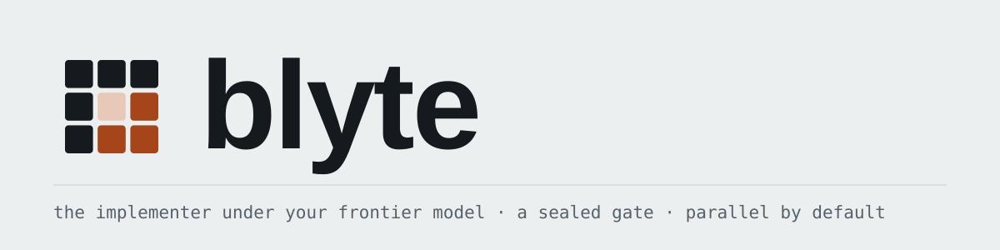
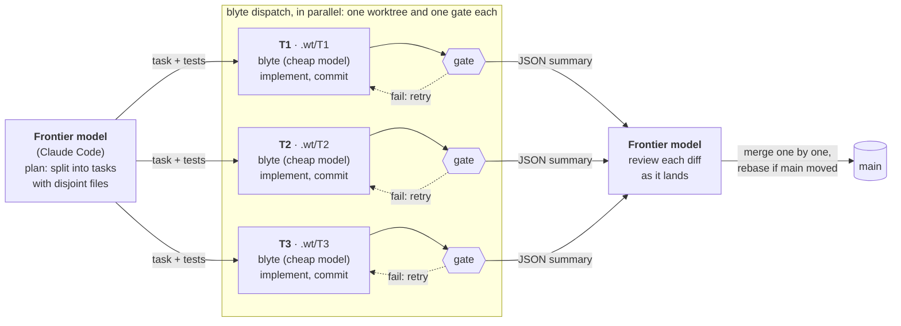

<p align="center">
  <picture>
    <source media="(prefers-color-scheme: dark)" srcset="docs/assets/blyte-banner-dark.svg">
    
  </picture>
</p>

<p align="center">
  <a href="https://github.com/climate-x-org/blyte/actions/workflows/ci.yml"></a>
  
  
  
</p>

**blyte is the implementer you put under a frontier model.** Plan with Claude Code (or any
frontier harness), then hand each well-specified task to blyte running on a cheap model. blyte
does the work in its own git worktree, and the repository's own check, run as a **sealed gate**,
decides whether it is done. The frontier model reviews the diff and merges.



Your frontier tokens go on the parts that need judgement: planning and review. The typing,
test-running and fixing runs on a cheaper model, inside a harness built to waste as little of it as
possible. In a first check against Claude doing the same work itself, Claude spent about a third as
much when blyte implemented, for the same result. blyte took longer; independent tasks run in
parallel, and adding blyte agents adds little frontier usage. This is how blyte itself is built.

**Get started:** [install blyte](#install) and run `blyte skill install`. From then on Claude Code
writes the plan and hands the implementation to blyte, independent tasks in parallel, checking each result.
[The workflow](docs/orchestration.md) explains what happens.

| | |
|---|---|
| **0.52×** the time, **0.63×** the cost | as an implementer, against agy (Google's Antigravity CLI) on the same 37 tasks, same model, same commit, both driven by Claude |
| **19 / 27** FrontierHarness tasks | blyte on its own on Gemini 3.8 Flash, no plan; the best published Kimi K3 configuration passed 17 / 27 |

Both come with caveats (one model, our own repositories, a single run on a different model from
the leaderboard's), and the comparison against a frontier model doing the whole task itself so far
covers one task. [The evidence page](docs/evidence.md) has the method and all the caveats.

Named after rust fungus (the blight Rust is named after), and bytes.

## Why blyte

- **"Done" means something.** `--gate` is a command, not a tool: the model cannot call it, skip it
  or grade itself. Every step of a multi-line gate runs and every failure comes back at once. A
  failed attempt can roll back to where the run started.
- **The turn is the unit of cost, so blyte saves turns.** Whole-file reads, all gate failures in
  one message, quick checks before the slow ones, and an append-only prompt that keeps the
  provider's cache valid, with old turns folded into a harness-written digest.
- **The harness gets out of the way.** A persistent shell session costs about 0.7 ms per command;
  `grep` and `glob` run in-process on ripgrep's libraries; no tool result can flood the context.
- **Sandboxed by default.** Commands cannot write outside the workspace (macOS Seatbelt, Linux
  Landlock), read credential stores or `.env` files (macOS), or see credential-looking environment
  variables; `--network=off` keeps code on the machine.
- **Honest numbers.** `--report` writes one JSON record per run: outcome, turns, true cost,
  per-call usage, where the time went, and the run's security settings.
- **Small on purpose.** Features that did not win in measurement (a daemon, an MCP server, a
  planner, a TDD mode, LLM summaries, …) were deleted. [The manifesto](MANIFESTO.md) explains the
  rules.

## Install

```bash
cargo install --git https://github.com/climate-x-org/blyte blyte --locked
export GEMINI_API_KEY=...          # the implementer's model; see Providers for others
```

## Quick start: with Claude Code

```bash
blyte skill install          # the skill, and blyte as Claude Code's default implementer
```

That's all. Ask Claude Code for a change as usual. It splits the work into independent tasks,
runs `blyte dispatch` for each **in parallel** (one worktree each, your check command as the
gate), reads each JSON summary, reviews each diff with `blyte review` and merges them in order.

- `--project` installs into the current repository instead (committed, so everyone gets it).
- `--no-default` installs the skill without making blyte the default; then ask for it: *"use
  blyte to implement this"*.
- `blyte skill uninstall` removes the skill and the `CLAUDE.md` block.
- `--harness codex` (or `all`) sets up Codex CLI the same way: skill, `AGENTS.md` block, and
  rules that let `blyte dispatch` run outside Codex's sandbox. Run end to end with Codex CLI on 2026-09-30. Any other orchestrator can do the same: `blyte dispatch` takes a task
file and a gate and prints JSON, and `blyte skill print` prints the instructions.

## Watch what's running

```bash
blyte dashboard --open       # http://127.0.0.1:7171, this machine only
```

The dashboard has two tabs. **Jobs** shows one row per job across your repositories: what it is
doing now, time, cost and turns, with the running ones first, the last 24 hours below, and a
**Needs attention** filter for failed runs nobody has dealt with yet. Click a row for the task,
gate failures, worktree and log; click a tag (repo, plan, harness, A/B pair) to see the jobs that
belong together. **Plans** shows each plan file with a task running now, drawn as a flow of its
tasks: lanes by area of code, columns by dependency order, each task coloured by its state; click a
task for its run. It reads the files `blyte dispatch` already writes, so there is nothing to set up:
it shows every repository blyte has worked in on this machine. You can also list repository folders
in `~/.config/blyte/dashboard.toml` ([Dashboard](docs/usage.md#dashboard)).

## Quick start: blyte on its own

```bash
# A gated run: exits 0 only when the check passes
blyte "fix the off-by-one in the lexer" --gate "cargo test -p lexer"

# A gate of several steps: all run, all failures are reported together
blyte "handle empty input in parse()" --gate 'cargo fmt --all --check
cargo clippy --all-targets -- -D warnings
cargo test'

# Budgets and a machine-readable report
blyte "$(cat task.md)" --gate "pytest" --max-seconds 1800 --max-cost 2 --report run.json

# Inside a running container
blyte "make the migration idempotent" --gate "pytest tests/test_migrations.py" \
  --container my-dev --container-workdir /app

# Keep the code on the machine
blyte "..." --gate "cargo test --offline" --network=off
```

> [!WARNING]
> With rollback on (the default), a failed gate resets the tree to the commit the run started
> from, discarding uncommitted changes. Start from a clean tree, or run blyte in its own worktree.

## Providers

The model name picks the provider:

| model name | provider | credentials |
|---|---|---|
| `gemini-3.8-flash-high` (default) | Google Gemini (`-low`/`-medium`/`-high` thinking) | `GEMINI_API_KEY` |
| `claude-…`, `anthropic/…` | Anthropic, with prompt caching | `ANTHROPIC_API_KEY` |
| `openai/<model>` | any OpenAI-compatible API, including local vLLM / LM Studio | `OPENAI_API_KEY`, `OPENAI_BASE_URL` |
| `openrouter/<vendor>/<model>` | OpenRouter | `OPENROUTER_API_KEY` |
| `<name>:<tag>`, `ollama/…` | Ollama, local or cloud | `OLLAMA_HOST` or `OLLAMA_API_KEY` |
| `chatgpt/<model>` | a ChatGPT subscription, via the Codex CLI's login | `~/.codex/auth.json` (read only) |

For the implementer, start with the default, Gemini 3.8 Flash: it is the model blyte has been
measured on. Credentials are read by blyte and never reach the commands the model runs. Details:
[docs/providers.md](docs/providers.md).

## Documentation

| | |
|---|---|
| [Getting started](docs/getting-started.md) | install, set up Claude Code, the first delegated task |
| [blyte as your implementer](docs/orchestration.md) | the plan → delegate → review workflow, and when to use it |
| [How tasks are written](docs/writing-tasks.md) | what the orchestrating agent writes for blyte, and why |
| [Running tasks](docs/usage.md) | the gate, budgets, rollback, containers, standalone runs |
| [Security and the sandbox](docs/security.md) | what commands can and cannot reach, per platform |
| [Run reports](docs/reports.md) | every field of `--report` |
| [How it works](docs/how-it-works.md) | the loop, folded context, the tools |
| [Evidence](docs/evidence.md) | the paired runs, FrontierHarness, and their caveats |
| [Manifesto](MANIFESTO.md) | fast and good, no bunk |

The docs are also a site: `uvx --with mkdocs-material mkdocs serve`.

## Contributing

Contributions are welcome; read [CONTRIBUTING.md](CONTRIBUTING.md) first. The short version: the
checks are `cargo fmt --all --check && cargo clippy --all-targets -- -D warnings && cargo test
--workspace --all-targets`, and a claim that something is faster needs a paired measurement.
Security reports: [SECURITY.md](SECURITY.md).

## License

Licensed under the [Apache License 2.0](LICENSE).
