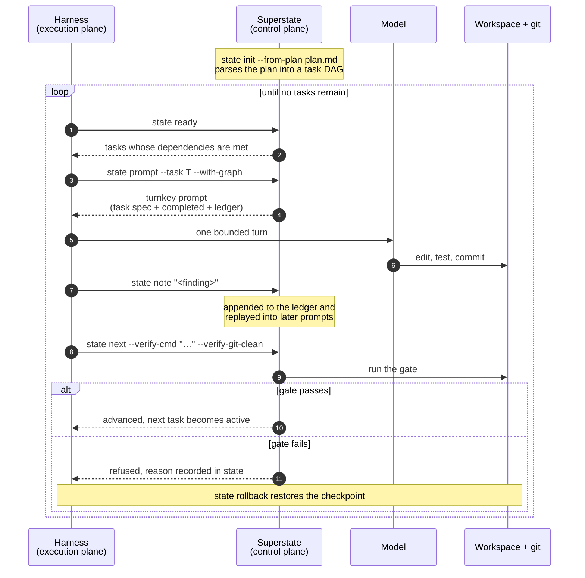

# Superstate

A control plane for coding agents.

Superstate does not run your agent's tools and does not talk to the model. It
decides which task the agent is given next, and whether the work it produces is
allowed to advance.

## Where this sits

Autonomous coding tends to be built in three layers. Superstate is the one above
the layer most teams already have.

| Layer | Owns | Examples |
|---|---|---|
| Model | Reasoning | Claude, Gemini, GPT |
| Harness (execution plane) | Tools, shell, file access, the conversation | Claude Code, Codex, Antigravity, Cursor |
| Control plane | Task selection and whether work may advance | Superstate |

The harness provides the agent's tools. The control plane sets the terms it works
under: one task at a time, drawn from a dependency graph, with no progress until a
verification command passes.

Superstate works with any harness that provides a standard toolset. It does not
replace one, and it is not tied to a particular model or vendor.

## Why not a skill?

Skills, rules files and system prompts are all documents the agent reads. Two
things follow from that.

The first is that a document is advice. It can be misread, deprioritised, or
dropped when the context window fills. `state next` runs a verification command,
and if that command fails the task does not advance. The difference is
enforcement rather than wording.

The second is that a document occupies the context window, competing with the
code under edit and growing as the conversation does. Superstate keeps the plan,
the completed set and the recorded findings on disk, and issues one self-contained
prompt per task. The prompt does not grow as tasks accumulate.

If an agent ignores a skill, nothing happens. If it ignores the gate, the task
stays where it is.

## The loop



Each turn receives the active task, what has already been completed, and any
findings recorded so far. It does not receive the transcript that produced them,
so the prompt stays roughly the same size whether the plan has three tasks or
thirty.

The state machine is fail-closed. A task that cannot pass its gate stays active,
and the reason is written into the state file rather than left in the caller's
terminal output, so a session resumed later can still explain why it stopped.

## Key Capabilities

- ⚡ **Deterministic State Engine (`superstate-core`)**: Mathematical DFA execution engine backed by `fd-lock` atomic file locks, checkpointing, and an append-only epistemic ledger.
- 🌳 **Polyglot Code Intelligence (`superstate-syntax`)**: High-speed symbol and AST hierarchy extraction powered by Tree-sitter across Rust, Python, TypeScript, and Go.
- 🛡️ **Zero-Noise Code Review (`superstate-review`)**: Daemon-less, git diff-driven adversarial code review system returning structured JSON findings.
- 📜 **Guidance & Rule Engine (`superstate-rules`)**: Deterministic Minijinja templates for generating universal agent guidance (`AGENTS.md`, `.cursor/rules`).
- 🔌 **Native Stdio MCP Server (`superstate-mcp`)**: Lightweight JSON-RPC 2.0 stdio server connecting state engine tools directly into Cursor, Claude Code, and Antigravity.
- 🩺 **5-Step Fail-Closed Doctor Handshake**: Automated verification probe ensuring binary integrity, active MCP loopback, client configurations, and file locks.

## Installation

```bash
# Clone the repository
git clone git@github.com:climate-x-org/superstate.git
cd superstate

# Install binaries locally
cargo install --path crates/superstate-cli
```

## Quick Start

### 1. Verify the installation
```bash
superstate doctor
```

### 2. Initialise state from a plan

The plan is ordinary markdown. Tasks are `### Task N: Title` headings, and
`**Depends on:**` lines make it a graph rather than a list.

```bash
superstate state init --from-plan docs/plan.md
```

### 3. Ask what can be worked on now

Returns only tasks whose dependencies are already complete.

```bash
superstate state ready --json
```

### 4. Get the prompt for a task

Self-contained: the task specification, what is already done, and findings
recorded so far.

```bash
superstate state prompt --task "Task 2: Backend adapter" --with-graph
```

### 5. Record what was learned

Notes are replayed into later prompts, so a task inherits earlier discoveries
without inheriting the conversation that produced them.

```bash
superstate state note "Parser needs a lookahead token for typed declarations"
```

### 6. Advance through the gate

The task advances only if the verification command passes and the tree is clean.

```bash
superstate state next --verify-cmd "cargo test --workspace" --verify-git-clean
```

Or run the verification and advance as one operation, checkpointing first so a
failure can be undone:

```bash
superstate state exec --verify-cmd "cargo test --workspace" \
    --checkpoint --rollback-on-fail
```

### Keeping a run healthy

```bash
superstate state status --json     # where things stand
superstate state metrics --json    # progress and telemetry
superstate state doctor --repair   # diagnose plan/state drift
superstate state sync --plan docs/plan.md   # plan revised mid-flight
superstate state resume            # briefing after a lost session
```

## Development & Verification

Ensure you have a modern Rust toolchain (2024 edition compatible):

```bash
# Run all workspace tests
cargo test --workspace --all-targets

# Check formatting
cargo fmt --all --check

# Run linter
cargo clippy --all-targets -- -D warnings
```

## Architecture

```
superstate/
├── crates/
│   ├── superstate-core/    # DFA state machine, atomic persistence, plan parser, verifier
│   ├── superstate-syntax/  # Polyglot Tree-sitter AST symbol extractor
│   ├── superstate-review/  # Adversarial code reviewer and git diff engine
│   ├── superstate-rules/   # Minijinja rules generator
│   ├── superstate-mcp/     # Native stdio JSON-RPC MCP server
│   └── superstate-cli/     # Unified CLI (superstate) and state runner (state)
```

## Contributing

Please see [CONTRIBUTING.md](CONTRIBUTING.md) for details on our code of conduct, conventional commit guidelines, and PR workflow.

## License

Licensed under the Apache License, Version 2.0. See [LICENSE](LICENSE) for details.
