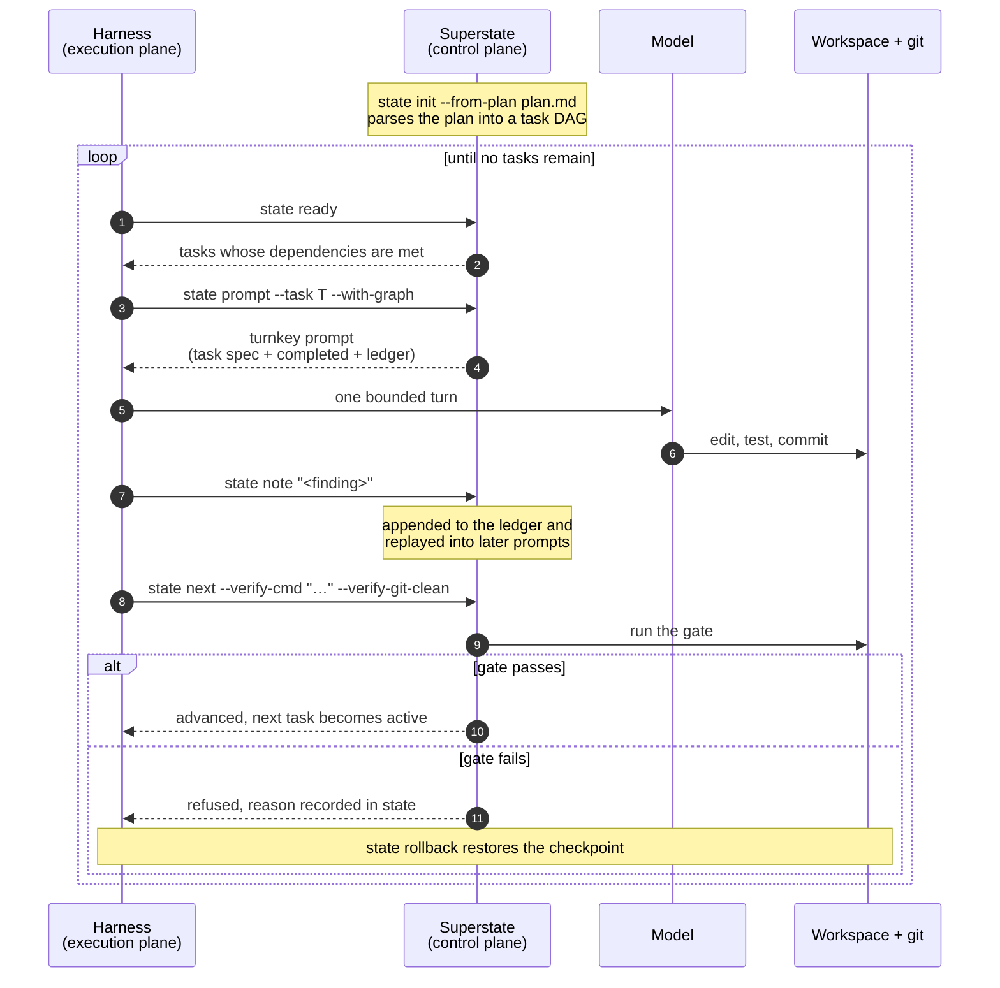

# Superstate

A control plane for coding agents.

Superstate does not run your agent's tools and does not talk to the model. It
decides which task the agent is given next, and whether the work it produces is
allowed to advance.

> Read **[The Superstate Manifesto](MANIFESTO.md)** for our core doctrine: why conversational LLM coding fails on real repositories, and the Five Invariants of autonomous software engineering.

## Where this sits

Autonomous coding tends to be built in three layers. Superstate is the one above
the layer most teams already have.

| Layer | Owns | Examples |
|---|---|---|
| Model | Reasoning | Claude, Gemini, GPT |
| Harness (execution plane) | Tools, shell, file access, the conversation | Claude Code, Codex, Antigravity, Cursor |
| Control plane | Task selection and whether work may advance | Superstate |

The harness provides the agent's tools. The control plane sets the terms it works
under: one task at a time, drawn from a dependency graph, with no progress until a
verification command passes.

Superstate works with any harness that provides a standard toolset. It does not
replace one, and it is not tied to a particular model or vendor.

## Why not a skill?

Skills, rules files and system prompts are all documents the agent reads. Two
things follow from that.

The first is that a document is advice. It can be misread, deprioritised, or
dropped when the context window fills. `state next` runs a verification command,
and if that command fails the task does not advance. The difference is
enforcement rather than wording.

The second is that a document occupies the context window, competing with the
code under edit and growing as the conversation does. Superstate keeps the plan,
the completed set and the recorded findings on disk, and issues one self-contained
prompt per task. The prompt does not grow as tasks accumulate.

If an agent ignores a skill, nothing happens. If it ignores the gate, the task
stays where it is.

## The loop



Each turn receives the active task, what has already been completed, and any
findings recorded so far. It does not receive the transcript that produced them,
so the prompt stays roughly the same size whether the plan has three tasks or
thirty.

The state machine is fail-closed. A task that cannot pass its gate stays active,
and the reason is written into the state file rather than left in the caller's
terminal output, so a session resumed later can still explain why it stopped.

## Key Capabilities

- ⚡ **Deterministic State Engine (`superstate-core`)**: Mathematical DFA execution engine backed by `fd-lock` atomic file locks, checkpointing, and an append-only epistemic ledger.
- 🌳 **Polyglot Code Intelligence (`superstate-syntax`)**: High-speed symbol and AST hierarchy extraction powered by Tree-sitter across Rust, Python, TypeScript, and Go.
- 🌿 **Isolated Milestone Worktrees (`superstate-worktree`)**: Automated git worktree lifecycle management targeting active feature branches with copy-on-write cache directory reflink support.
- 🔀 **Branch-Scoped State Isolation & Multi-Agent Concurrency**: Partitioned branch state storage (`.agent-state/branches/<branch>.json`) and reverse worktree discovery, allowing multiple autonomous agents or developer sessions to run in parallel on distinct feature branches with zero state collisions.
- 🛡️ **Zero-Noise Code Review (`superstate-review`)**: Daemon-less, git diff-driven adversarial code review system returning structured JSON findings.
- 📜 **Guidance & Rule Engine (`superstate-rules`)**: Deterministic Minijinja templates for generating universal agent guidance (`AGENTS.md`, `.cursor/rules`).
- 🔌 **Detached Handoff Gateway (`superstate-mcp`)**: Strict 4-tool JSON-RPC 2.0 stdio gateway initiating autonomous, out-of-loop background execution in isolated git worktrees (Cursor, Claude Code, Antigravity).
- 🩺 **5-Step Fail-Closed Doctor Handshake**: Automated verification probe ensuring binary integrity, active MCP loopback, client configurations, and file locks.

## Installation

```bash
# Clone the repository
git clone git@github.com:climate-x-org/superstate.git
cd superstate

# Install binaries locally
cargo install --path crates/superstate-cli
```

## Quick Start

### 1. Verify the installation
```bash
superstate doctor
```

### 2. Initialise state

Superstate supports multiple initialization workflows:

#### Direct multi-milestone handoff (0 markdown disk artifacts)

Initialise structured multi-milestone task DAGs directly in memory using `--milestones` with a JSON string or from stdin (`-`):

```bash
# Pass JSON directly
superstate state init --milestones '[
  {"title": "Implement models", "verify_cmd": "cargo test -p my-core", "files": ["src/models.rs"]},
  {"title": "Implement CLI commands", "verify_cmd": "cargo test -p my-cli"}
]'

# Or stream JSON via stdin
cat milestones.json | superstate state init --milestones -
```

#### Feature branch targeting, isolated worktrees & branch-scoped state isolation

When initialized within a git repository, Superstate automatically captures your active feature branch (e.g., `feat/payment-flow`), never defaulting to `main`:

1. **Branch-Scoped State Isolation:** Feature branches automatically resolve and persist state to `.agent-state/branches/<sanitized-branch>.json` (e.g., branch `feat/payment-flow` maps to `.agent-state/branches/feat-payment-flow.json`). Default branches (`main`, `master`) and non-git environments continue to default to `.agent-state/state.json` (100% backward compatible).
2. **Reverse Worktree Discovery:** Subagents and commands executing from inside an isolated worktree (`.wt/<task_slug>`) automatically discover and resolve to the parent feature branch state file without requiring `--state`.
3. **Turnkey Prompt State Contract:** Prompts rendered via `superstate state prompt` explicitly embed the state binding:
   ```markdown
   - **State File:** `/path/to/repo/.agent-state/branches/feat-payment-flow.json`
   - **Next Gate Command:** `superstate state next --state "/path/to/repo/.agent-state/branches/feat-payment-flow.json"`
   ```
   ensuring agents and automated runners always advance against the exact branch state.
4. **Isolated Worktree Provisioning:** Superstate provisions an isolated worktree for the active milestone (`.wt/task-1` on branch `wt/task-1`) branched off your active feature branch.
5. **Automatic Sequential Progression:** When `superstate state next --verify-cmd "..."` succeeds, Superstate commits any uncommitted worktree changes, merges the worktree cleanly into your active feature branch, cleans up `.wt/task-1`, and automatically provisions the next worktree (`.wt/task-2`) with the latest base branch state.

#### From a markdown plan

The plan is ordinary markdown. Tasks are `### Task N: Title` headings, and
`**Depends on:**` lines make it a graph rather than a list.

```bash
superstate state init --from-plan docs/plan.md
```

### 3. Ask what can be worked on now

Returns only tasks whose dependencies are already complete.

```bash
superstate state ready --json
```

### 4. Get the prompt for a task

Self-contained: the task specification, what is already done, and findings
recorded so far.

```bash
superstate state prompt --task "Task 2: Backend adapter" --with-graph
```

### 5. Record what was learned

Notes are replayed into later prompts, so a task inherits earlier discoveries
without inheriting the conversation that produced them.

```bash
superstate state note "Parser needs a lookahead token for typed declarations"
```

### 6. Advance through the gate

The task advances only if the verification command passes and the tree is clean.

```bash
superstate state next --verify-cmd "cargo test --workspace" --verify-git-clean
```

Or run the verification and advance as one operation, checkpointing first so a
failure can be undone:

```bash
superstate state exec --verify-cmd "cargo test --workspace" \
    --checkpoint --rollback-on-fail
```

### Keeping a run healthy

```bash
superstate state status --json     # where things stand
superstate state metrics --json    # progress and telemetry
superstate state doctor --repair   # diagnose plan/state drift
superstate state sync --plan docs/plan.md   # plan revised mid-flight
superstate state resume            # briefing after a lost session
superstate state list              # ASCII table view across all active & completed branches
superstate state list --json       # machine-readable JSON array of branch state summaries
```

#### Inspecting branch execution states (`state list`)

View all active and completed branch states across the repository in a clear ASCII table:

```bash
superstate state list
```

```text
Active & Completed Branches:
  Branch                     Status       Active Task              Step   Base Branch         
  feat-payment               InProgress   task-1: Add Stripe       1/2    main                
  feat-analytics             InProgress   task-1: Export Analytics 1/1    main                
  main (default)             Completed    -                        3/3    main                
```

Or query structured JSON for automation or multi-agent orchestrators:

```bash
superstate state list --json
```

```json
[
  {
    "branch": "feat-payment",
    "status": "in_progress",
    "active_task": "task-1: Add Stripe",
    "step": 1,
    "total_steps": 2,
    "base_branch": "main",
    "state_file": "/path/to/repo/.agent-state/branches/feat-payment.json"
  }
]
```

## Multi-Agent Concurrency

Superstate is built from the ground up for concurrent multi-agent development where multiple autonomous agents (e.g., Claude Code, Cursor, Antigravity, or parallel CLI subagents) and human developers operate simultaneously in the same repository:

- **Zero State Collisions:** Each agent running on a feature branch (e.g., `feat/billing`, `feat/auth`) automatically writes to its own isolated state file in `.agent-state/branches/<sanitized-branch>.json`. Because state files are partitioned per branch, multiple agents can initialize, checkpoint, fail, or advance without mutating or locking each other's execution DAGs.
- **Independent Git Worktrees:** Each milestone executes inside an isolated git worktree (`.wt/<task_slug>`) branched from the owning feature branch. Agents run isolated builds, tests, and edits without git index contention or file lock collisions. Shared build directories (e.g. `target/`, `node_modules/`) utilize copy-on-write reflinks for speed.
- **Reverse Worktree Discovery for Subagents:** When an orchestrator dispatches a subagent into `.wt/<task_slug>`, the subagent can invoke CLI commands (`superstate state show`, `superstate state next`) without needing an explicit `--state` flag. Superstate inspects `.agent-state/branches/*.json` and matches the active worktree path back to its parent branch state file automatically.
- **Explicit Turnkey Prompt Contracts:** Turnkey prompts produced by `superstate state prompt` explicitly declare `- **State File:** <path>` and `- **Next Gate Command:** superstate state next --state "<path>"`, eliminating ambiguity when orchestrating across agent boundaries.
- **Repository-Wide Visibility:** Orchestrators can invoke `superstate state list [--json]` at any time from any worktree or repository root to monitor the real-time status, active tasks, and progression steps across all concurrent agent runs.

## Detached Handoff Gateway (`superstate-mcp`)

Per **[ADR 0002](docs/adr/0002-detached-handoff-and-native-rust-harness.md)**, Superstate permanently deprecates in-loop MCP state-machine execution as an anti-pattern. Instead of trapping LLMs inside the chat session with in-loop state mutation tools, `superstate-mcp` exposes strictly **4 Gateway tools** designed to validate intent, provision isolated workspaces, and hand off execution to the native Rust daemon harness:

- **`superstate_handoff`**: The sole execution entrypoint. Validates verification commands, provisions an isolated worktree (`.wt/<task-slug>`), initializes in-memory state, and detaches the background native daemon (`detach: true` by default). The chat agent is released immediately.
- **`superstate_status`**: Clean observability into active background jobs, milestone DAG progress, and daemon health without mutating state.
- **`superstate_cancel`**: Sends a graceful termination signal (`SIGTERM` -> `SIGKILL`) to running background workers and reaps PID records.
- **`superstate_doctor`**: Fail-closed diagnostic probe validating binary integrity, driver availability, and environment readiness.

All legacy in-loop tools (`state_init`, `state_next`, `state_prompt`, `state_apply`, `worktree_*`) have been removed from the MCP catalog and return descriptive migration errors directing callers to `superstate_handoff`.

## Development & Verification

Ensure you have a modern Rust toolchain (2024 edition compatible):

```bash
# Run all workspace tests
cargo test --workspace --all-targets

# Check formatting
cargo fmt --all --check

# Run linter
cargo clippy --all-targets -- -D warnings
```

## Architecture

```
superstate/
├── crates/
│   ├── superstate-core/      # DFA state machine, atomic persistence, plan parser, verifier
│   ├── superstate-syntax/    # Polyglot Tree-sitter AST symbol extractor
│   ├── superstate-review/    # Adversarial code reviewer and git diff engine
│   ├── superstate-rules/     # Minijinja rules generator
│   ├── superstate-worktree/  # Isolated git worktrees and active branch targeting
│   ├── superstate-mcp/       # Native stdio JSON-RPC MCP server
│   └── superstate-cli/       # Unified CLI (superstate) and state runner (state)
```

## Contributing

Please see [CONTRIBUTING.md](CONTRIBUTING.md) for details on our code of conduct, conventional commit guidelines, and PR workflow.

## License

Licensed under the Apache License, Version 2.0. See [LICENSE](LICENSE) for details.
