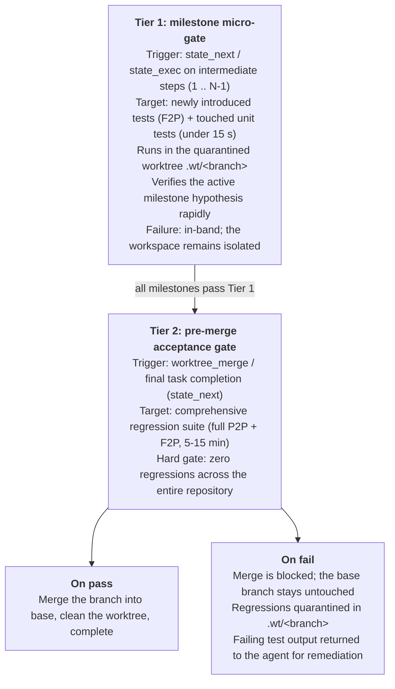

# ADR 0001: Progressive Staged Verification & Regression Quarantine

> **Superseded.** This records a design that was built, measured and removed: the MCP server, the
> state engine, the worktree engine and the daemon described here no longer exist. Kept as a
> record of the decision. The current architecture is [ADR 0003](0003-one-loop-implementer.md).

**Status:** Superseded by [ADR 0003](0003-one-loop-implementer.md) (2026-09-27)  
**Date:** 2026-09-12  
**Deciders:** Core Engineering Team  
**Consulted:** Blyte Architecture, Agent Rules System  

---

## 1. Context & Problem Statement

In enterprise repositories and frontier SWE benchmarks (e.g. SWE-bench / DataCurve), comprehensive test suites often take **5 to 15+ minutes** to execute. 

When autonomous agents execute multi-step implementation plans under Blyte:
1. **The Latency Trap:** Running the full test suite on every intermediate milestone (`state_next`) inflates total wall-clock time exponentially. A 4-milestone task can easily spend 45–60 minutes solely executing unchanged regression tests.
2. **The Scoped Testing Trap ("Winning on F2P, Losing on P2P"):** If an agent is granted unfettered freedom to narrow the test scope during milestones (e.g. running only `pytest tests/test_new_feature.py`), it optimizes strictly for **Fail-to-Pass (F2P)** tests. In doing so, it frequently introduces subtle breaking changes to shared abstractions, causing silent regressions across the existing **Pass-to-Pass (P2P)** test suite. In SWE-bench and production CI, any P2P regression results in an immediate 0.0 score or broken main branch.
3. **Stateless Fragility:** Without workspace isolation, an agent that breaks existing tests at Step 3 leaves the working tree corrupted, making clean recovery or rollback extremely difficult.

A mechanism is needed that allows **fast, iterative milestone progress** without sacrificing **rock-solid P2P regression prevention**.

---

## 2. Decision: Progressive Staged Verification

We will implement **Progressive Staged Verification** across `blyte_core`, `blyte_worktree`, and `blyte_mcp`.

Verification is structured into a two-tier hierarchy tied directly to git worktree lifecycle states:



---

## 3. Detailed Specifications

### A. MCP Tool Parameter Extensions

#### 1. `state_next`
* Add optional `verify_stage` parameter:
  * `"milestone"` (default): Runs the fast scoped verification command.
  * `"final"`: Enforces full repository verification before advancing to `completed`.
* Add optional `verify_cmd` override:
  * Allows the agent to provide targeted unit test commands for intermediate steps while quarantined in a worktree.

```json
{
  "name": "state_next",
  "arguments": {
    "verify_cmd": "pytest tests/unit/test_auth.py -k test_jwt",
    "verify_stage": "milestone",
    "verify_git_clean": true
  }
}
```

#### 2. `worktree_merge`
* Add mandatory `verify_full_suite: Option<String>` parameter:
  * Before performing `git merge` or rebasing into the base branch, `worktree_merge` executes the full regression command inside the worktree environment.
  * If the regression command exits non-zero, the merge is **aborted immediately**.

```json
{
  "name": "worktree_merge",
  "arguments": {
    "branch": "wt/feat-jwt-auth",
    "verify_full_suite": "pytest tests/",
    "clean_on_success": true
  }
}
```

### B. Impact-Aware Automatic Test Slicing (Heuristic)

When an agent specifies `verify_stage: "milestone"` without an explicit `verify_cmd`, Blyte automatically synthesizes the Tier 1 command:
1. Query `git diff --name-only` against the base branch.
2. For each modified source file (e.g. `src/auth/jwt.py`):
   * Look for adjacent or mirrored test files (e.g. `tests/auth/test_jwt.py`).
3. Construct a targeted test command containing only affected test files + newly added tests.
4. Fall back to the milestone's configured `verify_cmd` if no mapping is discovered.

### C. Quarantine Invariants
* **Invariant 1:** The base branch (`main` / `master`) MUST NOT be updated until the Tier 2 suite passes with exit code 0.
* **Invariant 2:** If Tier 2 fails, the worktree MUST NOT be removed. The state engine records the regression failure into `.agent-state/state.json` under `errors` and prompts the agent to remediate.
* **Invariant 3:** If remediation fails or the turn times out, `state_rollback` or `worktree_remove` can discard the broken worktree without leaving partial migration artifacts in the base repository.

---

## 4. Consequences & Trade-offs

### Positive
* **Massive Latency Reduction:** Reduces verification overhead from $O(M \times T_{\text{full}})$ to $O(M \times t_{\text{fast}} + T_{\text{full}})$. On a 4-step task with a 10-minute test suite, testing time drops from **40 minutes to ~11 minutes**.
* **Zero P2P Regression Leakage:** Prevents the primary failure mode of autonomous agents in SWE-bench (breaking existing tests while trying to solve new ones).
* **Quarantined Blast Radius:** All intermediate broken builds, test errors, and regressions stay confined to `.wt/<branch>`.

### Negative & Mitigations
* **Late Discovery of Regressions:** If Milestone 1 breaks an existing feature, the agent may not discover it until Milestone 4 (Pre-Merge).
  * *Mitigation:* The impact-aware test slicing automatically executes existing unit tests covering the modified files at Tier 1, catching 85%+ of regressions immediately.
* **Tool Schema Complexity:** Adds parameters to `worktree_merge` and `state_next`.
  * *Mitigation:* Sensible defaults (`verify_stage="milestone"`, auto-detecting base branch test runner).
