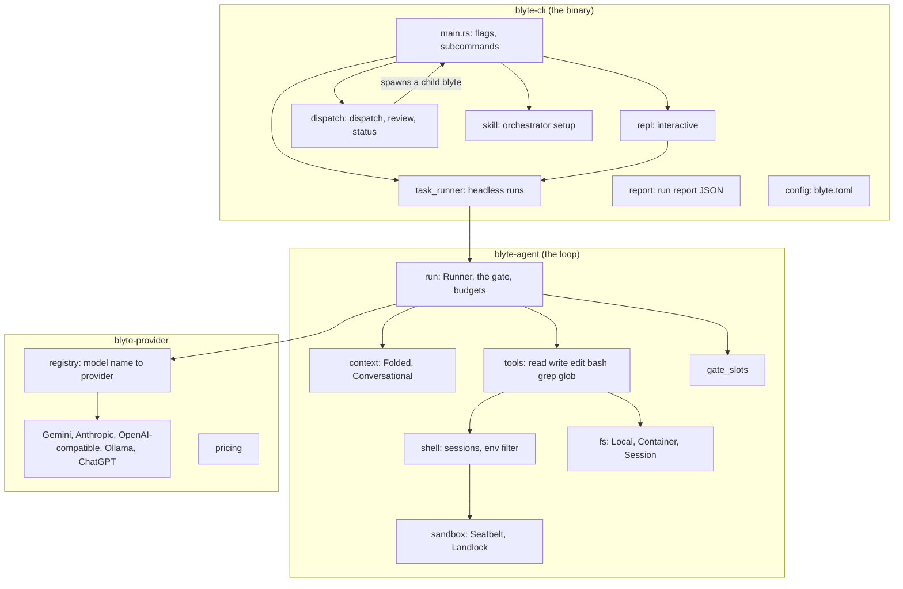
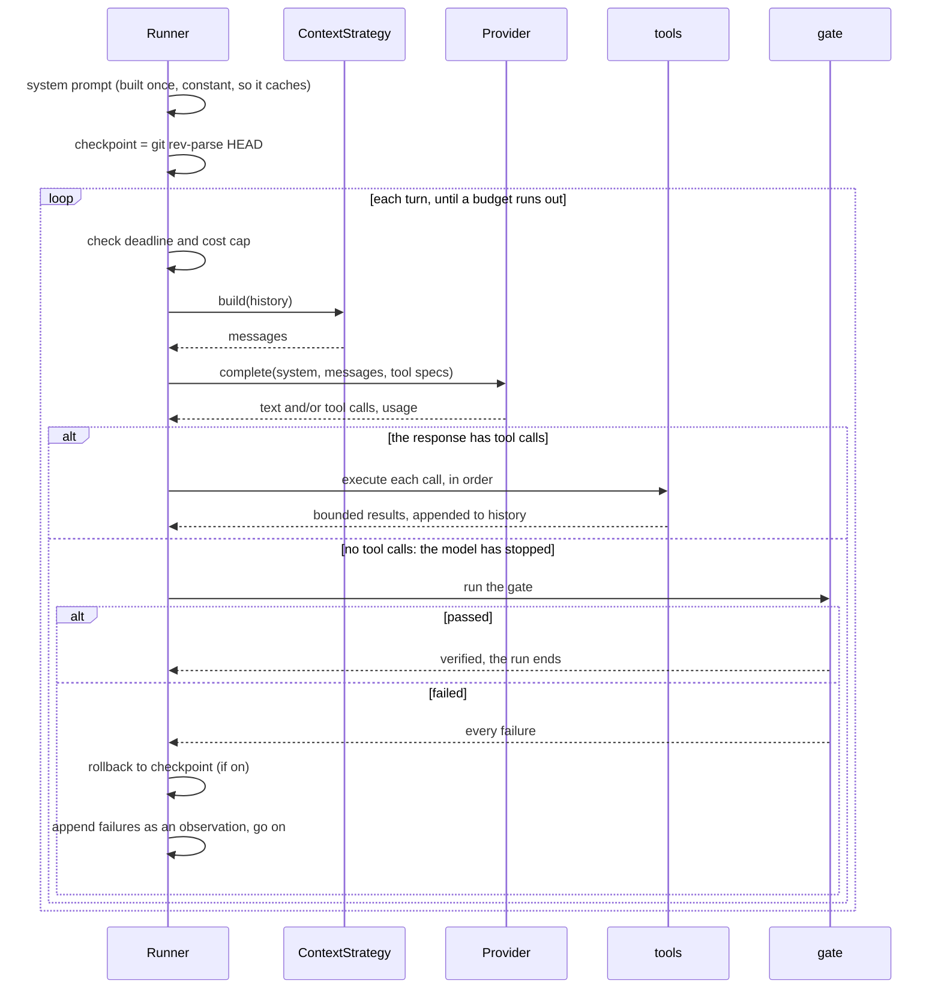
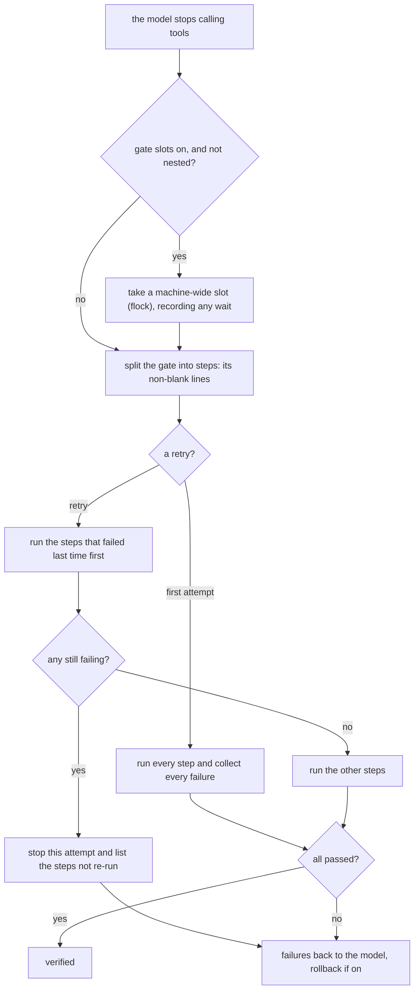
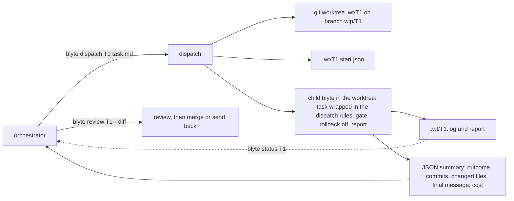

# Architecture deep dive

[How it works](how-it-works.md) gives the short version. This page follows one run through the
code: which crate owns what, what happens on each turn, how the gate, the shell and the sandbox
work, and how `blyte dispatch` sits above all of it. Each design choice is tied to the
measurement that led to it, because in blyte a mechanism has to earn its place.

## The crates and their seams



`blyte-agent` doesn't know which model it talks to, where commands run or how the prompt is
shaped. It sees four traits, and the CLI chooses an implementation of each:

| trait | what it abstracts | implementations |
|---|---|---|
| `Provider` (`blyte-provider`) | one model call: `complete(&Request) -> Response` | Gemini, Anthropic, OpenAI-compatible (OpenAI, OpenRouter), Ollama, ChatGPT |
| `Shell` | running a command: `exec` (the harness's own commands) and `exec_user` (the model's `bash`) | `PersistentShell` (local, sandboxed or container), `LocalShell`, `ContainerShell` |
| `Fs` | reading, writing and resolving files | `LocalFs`, `SessionFs` (through the shell session), `ContainerFs` |
| `ContextStrategy` | turning the history into the prompt | `Folded` (default), `Conversational` |

The `Shell` seam exists because of a bug in the harness blyte replaced. There, dependencies lived
in a container and the worker was *told in prose* to reach them through a wrapper script. When that
instruction dropped out of the prompt, the worker edited the host while its checks ran in the
container. With a seam, the model sees `bash` wherever it runs, and there's no instruction to
forget. The environment probe (`available_binaries`) also runs through the seam, so a container
run reports what's installed in the container, not on the host.

## One run, turn by turn

`Runner::run` (in `crates/blyte-agent/src/run.rs`) is the whole loop. The CLI builds a `Runner` from
a provider, a shell, a file system, a context strategy, a budget and the rollback setting, then
hands it a `State`, which holds the goal and the gate command.



Details that matter:

- **The system prompt is built once** and never changes during the run, so every provider's
  prompt cache can serve it. It states the goal, how completion is decided, where commands run,
  the binaries available, and the rule to change nothing outside the repository.
- **No tool calls means "I'm done."** The model has no `finish` tool and can't claim to be
  finished. When a response has no tool calls, the runtime runs the gate.
- **A truncated reply gets another turn instead of being acted on.** When a reply hits the output
  token limit (`MAX_TOKENS`, `CONTINUATION`, `max_tokens`, `length` or `incomplete`), its partial
  text and tool calls are discarded, a harness note asks the model to reply more briefly, and
  `truncated_turns` is incremented.
- **A turn's tool calls run in order, and their results come back together.** The history records
  all of a turn's calls first, then all of their results, because Gemini signs only the first
  call of a parallel batch and rejects a history that interleaves them.
- **Transient provider errors** (rate limits, 5xx, dropped connections) are retried up to 6 times,
  with backoff or the server's own retry hint, but never past the deadline. An exhausted
  quota ends the run as `error` with the provider's message, instead of retrying forever.
- **Budgets are checked before each turn**: turns, wall-clock time (`--max-seconds`) and cost
  (`--max-cost`, priced from the provider's reported usage). The harness stops itself and writes
  its report, rather than being killed from outside with its telemetry lost.
- **Empty turns are counted.** In the harness blyte replaced, 47.6% of all input tokens went to
  turns that only waited on a background job, so the report records turns that produced neither
  text nor a tool call.

A run ends in one of four outcomes: `verified` (the gate passed; the only success),
`gate_failed` (the gate failed `--max-gates` times), `budget_exhausted`, or `error` (the provider
or the environment broke, which is distinct from failing work).

## The gate

The gate is a command, not a tool. The model is told a check exists and what it is, but nothing
in the tool surface can reach `run_gate`.



- **Steps.** A multi-line gate is several steps. On the first attempt every step runs, so the
  model gets all of its failures in one message instead of finding them one by one.
- **Failing first on retries.** A retry runs the steps that failed last time first. If any still
  fails, the attempt stops without re-running the slow steps that already passed. The message
  lists the steps that weren't re-run.
- **Gate slots** (`gate_slots.rs`). Parallel dispatches on one machine would otherwise build and
  test all at once. Each gate takes one of N machine-wide slots: `flock` on files in
  `$TMPDIR/blyte-gate-slots`, N defaulting to an eighth of the cores (measured on 12 cores:
  three builds in parallel took 49 s, one after another 47 s). Only the `blyte` command turns
  slots on. Gate commands run with `__BLYTE_IN_GATE=1`, so a blyte started inside a gate, such as
  the runner tests in blyte's own `cargo test`, never waits for the slot its parent holds.
- **Rollback.** With rollback on (the default for a direct run), a failed gate resets the tree to
  the starting commit (`git reset --hard` and `git clean -fd`), and the model is told its edits are
  gone. `blyte dispatch` turns rollback off, because the implementer commits as it goes.
- **Failure is an observation.** The failures go back to the model as a user message: what the
  command printed, and a rule. If the change caused the failure, fix the change, not the machine.
  If the environment caused it (disk, network, a missing service), say so and stop. This rule
  came from an incident: after an environment failure, an implementer spent 50 minutes clearing a
  host cache.
- **No gate.** When there's no check command, the prompt tells the model to verify the work
  itself, and to re-run the searches that found the problems before it stops.

## Context: what each turn sends

Every turn re-sends the conversation, so the shape of the prompt decides the bill. `Folded`, the
default, keeps the prompt **append-only** so the provider's prefix cache stays valid:

```
[system] [opening: the task] [digest 1] … [digest k] [recent turns, verbatim]
```

When the verbatim tail passes the fold budget (48K tokens by default, 96K for research runs, estimated as characters ÷ 4),
its older half becomes one digest: a line per tool call, written by the harness, not summarised
by a model. Fold boundaries are computed greedily from the start of the history, so each depends
only on the messages before it. The next turn reproduces every earlier fold exactly, so between
folds the prompt only grows at the end. A cut never separates a tool call from its result.

The report checks this: each turn records whether its prompt was the previous prompt plus new
messages (`appended`) and how many characters were new. Fresh input far above that on an appended
turn is a cache miss.

`Conversational` sends the history unchanged. It's kept as the baseline that `Folded` is measured
against.

## Tools

Six tools, all synchronous. The tools module documents the rule that shapes them: there's no
`run_in_background`, no job registry, no polling. A slow test suite should cost wall-clock time,
which is free, not turns, which aren't.

| tool | implementation | bounds |
|---|---|---|
| `read` | through `Fs`, whole file or a line range | 2,000 lines, 2,000 characters a line |
| `write` / `edit` | through `Fs`; `edit` needs a unique exact match | |
| `bash` | the persistent user session (`exec_user`) | 5-minute deadline, 400 lines (head and tail) |
| `grep` | local: in-process, with ripgrep's libraries. Container: one command, `rg` if present, else `grep -rnIE` | 200 matches; long lines cut to excerpts around up to 5 matches |
| `glob` | local: in-process, respecting `.gitignore`; container: one `git ls-files`, matched in-process (`pattern`, optional `path` under the workspace or a read root) | 200 matches |

Every path is resolved inside the workspace first. Every result goes through one bounding step
(`tools::execute`), and no result exceeds 60K characters. `read` returns whole files by default
because every extra turn re-sends the prompt: paging through a 650-line file once cost 15 turns.

## The shell: one long-lived bash per purpose

A `PersistentShell` keeps two `bash -l` sessions:
- the **user** session runs the model's `bash` calls, so `cd` and `export` carry over as in a
  terminal;
- the **harness** session runs blyte's own commands (the gate, checkpoints, probes), each in a
  subshell, so none of them changes the model's session.

The protocol (`Session::run`) avoids spawning helper processes, which cost about 25 ms a command
on macOS:

1. The command is sent as a heredoc, read into a variable with the `read` builtin. The heredoc
   delimiter includes a per-process nonce, so no command or file content can end it early.
2. `eval` runs the command with stdout and stderr redirected to two files in the session's
   scratch directory, which is re-created before each command in case a command deleted it.
3. One `printf` returns a header, `__BLYTE_<id>__ <exit> <stdout bytes> <stderr bytes>`,
   followed by both outputs. The reader takes exactly that many bytes, so any output, binary
   or containing marker-like text, comes back intact.

A round trip costs a few milliseconds; a `docker exec` per call cost 60–110 ms. If a command
passes its deadline, or the shell dies (for example, the model ran `exit`), the session is
killed. What the command had written is recovered from its output files, and the next call starts
a fresh session in the workspace root. The protocol's own reads end in `|| true`, so a model's
`set -e` can't take the session down.

Two things are set when a local session starts:
- **The PATH is restored.** macOS `path_helper` in the login profile reorders `PATH`, so the
  inherited `PATH` is put back in front.
- **The environment is filtered.** Provider credentials, anything that looks like one (a
  credential-like name segment, or a URL with inline credentials) and every `BLYTE_*` variable are
  withheld from the commands, unless `--pass-env` names them. Container commands never inherit
  the host environment.

## The sandbox

Local sessions start under a platform sandbox (`sandbox.rs`), chosen when the shell is built:

| | macOS: Seatbelt | Linux: Landlock |
|---|---|---|
| mechanism | `sandbox-exec` with a generated SBPL profile | rules applied in the child before `bash` starts |
| writes | the workspace, the git common directory, temp directories and standard tool caches | the same set |
| reads | everything except credential stores and `.env` files (denied as `file-read-data`, so `stat` still works for tools like pytest), plus `--allow-read` grants | an allowlist: system directories, the workspace, tool caches under `$HOME`, `--allow-read` |
| `--network=off` | outbound denied; loopback and Unix sockets allowed; Docker sockets denied | outbound TCP denied (Landlock ABI 4, Linux 6.7+) |

A container run relies on the container's own isolation instead, and `--network=off` is refused
there (set the container's network instead). The run report records which sandbox, profile and
network setting each run used. See [Security](security.md) for the full policy.

## Providers

`registry::resolve_provider` maps a model name to an adapter:
- a prefix picks the provider explicitly: `anthropic/`, `gemini/`, `openai/`, `openrouter/`,
  `ollama/`, `chatgpt/`;
- otherwise the name's family decides: `claude…` or `gemini…`, and a `:` tag means Ollama;
- with no model given, the credentials in the environment decide.

Each adapter translates the neutral `Request`, `Message` and `ToolSpec` into its own wire format
and back. Two details:
- a `ToolCall` carries an opaque `signature`, which Gemini 3.x requires to be sent back verbatim;
- `Usage` keeps cached input separate from fresh input, because that split is most of the cost
  of a long run.

HTTP is blocking (`ureq`, no async runtime), through one pooled client per process, so every call
after the first reuses a connection. `pricing` turns usage into dollars for the models it knows,
which is what `--max-cost` and the report's `cost_usd` use.

## The CLI layer

- **Headless runs** (`task_runner`) wire the pieces together: the provider from `--model`, the
  shell (container, sandboxed local or plain local), the matching `Fs`, the context strategy,
  the budget, and the gate from `--gate`. The run writes a report (`--report`), the machine-readable
  contract that blyte-eval reads (see [Run reports](reports.md)).
- **The REPL** sends each prompt through the same task runner, keeping the goal and gate between prompts.
- **`blyte.toml`** (`blyte init`) stores a repository's gate and dispatch defaults, so an
  orchestrator doesn't have to repeat them.

## Dispatch: blyte under an orchestrator

`blyte dispatch <id> <task>` is how a frontier model hands blyte one task
([the workflow](orchestration.md)):



- **The gate** comes from `--gate` or from `blyte.toml`. A dispatch with neither is refused.
- **Defaults:** 300 turns, one hour, rollback off. The task is wrapped in fixed rules: stay in
  the task and the worktree, never change the machine to make a check pass, never push or read
  secrets, commit with the given message, finish with a short report.
- **The outcome** is the report's, with one change: a verified run with no commits is
  `no_changes` (exit 4), because a task that changed nothing isn't done.
- **Parallelism is one process per task,** each in its own worktree, with gate slots so that
  their builds and tests don't all run at once.

## Measuring the harness itself

```bash
cargo run --release -p blyte-agent --example harness_bench
```

measures blyte's own overhead per command and per turn, with no model involved. Across a
200-turn run the harness spends about 2 seconds of its own time; the rest is the model and the
commands it chose.
