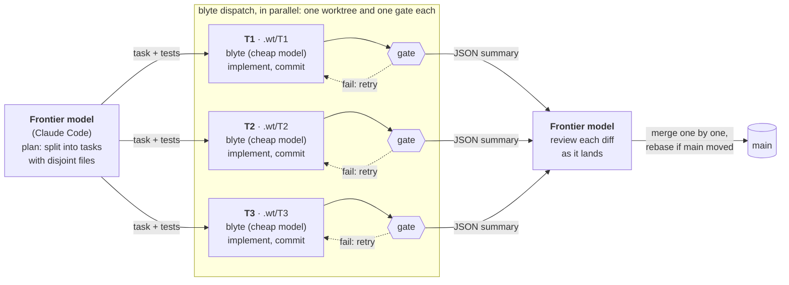

---
hide:
  - navigation
---

# blyte documentation

blyte is the implementer you put under a frontier model. Plan with Claude Code or another
frontier harness, then hand each well-specified task to blyte running on a cheap model. blyte
works in its own git worktree, your check command decides when the task is done, and the frontier
model reviews the result and merges it.

## Set up in four steps

1. **Install blyte:** `cargo install --git https://github.com/climate-x-org/superstate blyte --locked`
2. **Give it a cheap model:** `export GEMINI_API_KEY=...` (or [another provider](providers.md)).
3. **Install the Claude Code skill:** `blyte skill install`
4. **Ask Claude Code:** *"Plan this change, then use blyte to implement each task and review the
   results."*

[Getting started](getting-started.md) walks through each step, and how to run blyte on its own.

## Find what you need

<a class="b-card b-card-wide" href="orchestration/"><strong>The workflow: plan, delegate, review</strong>How Claude Code (or any orchestrator) hands tasks to blyte, verifies them and merges; when to delegate and when not to.</a>
<a class="b-card" href="getting-started/"><strong>Get set up</strong>Install, choose a model, connect Claude Code, delegate a first task.</a>
<a class="b-card" href="writing-tasks/"><strong>Write tasks blyte gets right</strong>The template, the tests, checking a task before sending it, sizing.</a>
<a class="b-card" href="usage/"><strong>Tune a run</strong>Gates with several steps, budgets, rollback, containers, standalone use.</a>
<a class="b-card" href="providers/"><strong>Choose the implementer model</strong>What has been measured, the six providers, credentials, retries, cost.</a>
<a class="b-card" href="security/"><strong>Know what commands can touch</strong>The sandbox on macOS and Linux, credential reads, the environment filter, <code>--network=off</code>.</a>
<a class="b-card" href="reports/"><strong>Read a run's results</strong>Every field of <code>--report</code>: outcome, turns, cost, timing, security settings.</a>
<a class="b-card" href="reference/cli/"><strong>Look up a flag</strong>The full <code>blyte --help</code> and the environment variables blyte reads.</a>
<a class="b-card" href="how-it-works/"><strong>Understand the design</strong>The loop, the sealed gate, folded context, the tools and their limits.</a>

## Key ideas

**The gate.** `--gate` is a command, not a tool the model can call. When the model says it is
finished, blyte runs every step of the gate; exit 0 is `verified`, anything else goes back to the
model with all the failures at once. See [Running tasks](usage.md#the-gate).

**Rollback.** By default a failed gate resets the tree to the commit the run started from,
discarding uncommitted changes. Start from a clean tree or a dedicated worktree.

**Budgets.** Every run is bounded by turns (`--max-turns`) and gate attempts (`--max-gates`), and
optionally by wall-clock time (`--max-seconds`) and spend (`--max-cost`).

**The sandbox.** On by default: commands cannot write outside the workspace, and on macOS cannot
read credential stores. See [Security](security.md).

**One job.** blyte implements one task per run. Planning, splitting work and review belong to
the frontier model or person driving it: see [the workflow](orchestration.md).

## Background

- [Manifesto](manifesto.md): the design rules and why they exist.
- [Evidence](evidence.md): how blyte has been measured, and the caveats.
- [The architecture decision](adr/0003-one-loop-implementer.md) and
  [research notes](research/2026-09-24-harness-research.md).
