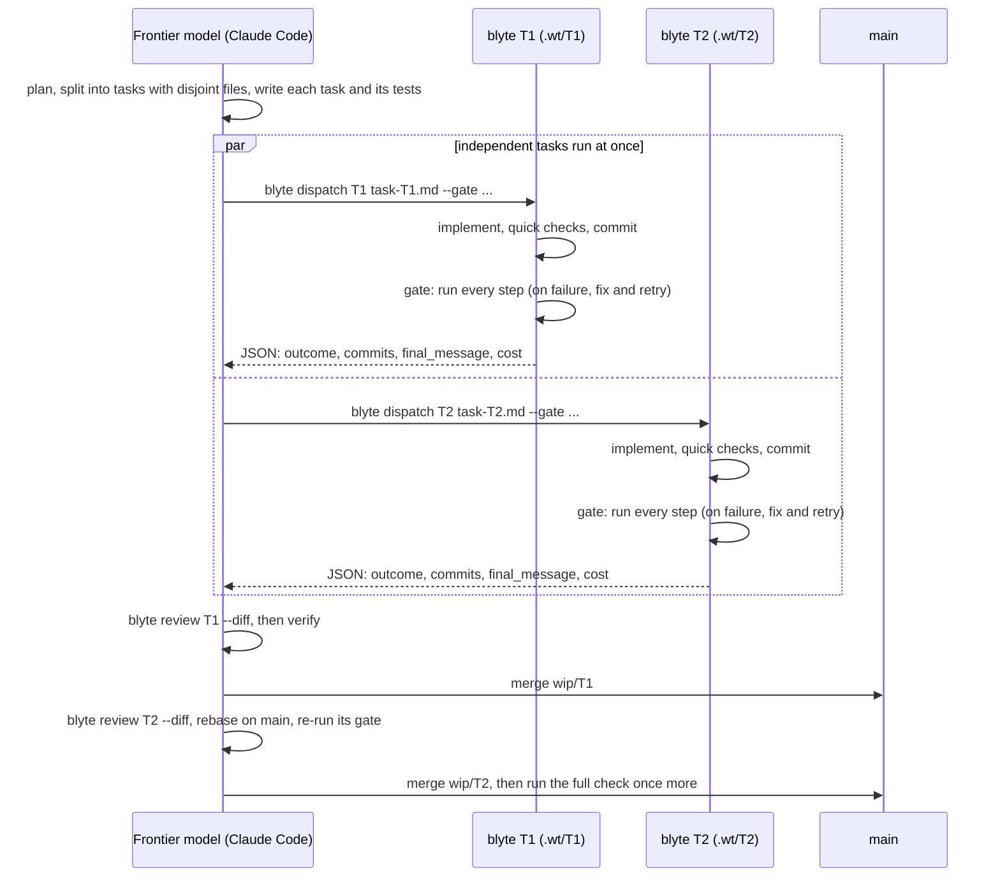

# blyte as the implementer for a frontier model

A pattern that works well: a frontier model (Claude Code, for example) **plans and reviews**, and
hands each well-specified task to blyte, which **implements** it on a cheaper model. The
repository's check command, run by blyte as its sealed gate, decides whether the work is done. The
frontier model then verifies the result and merges it.



## Why it works

- **Each model does what it is good at.** Planning, judging ambiguity and reviewing a diff are
  where a frontier model earns its price. Typing out a specified change, running the tests and
  fixing what they report is work a cheaper model does well inside a good harness.
- **The gate makes the cheap model's work checkable.** blyte cannot declare itself done: the check
  passes or it does not, and every failure comes back to the model at once.
- **The report tells the orchestrator what to do next.** `outcome`, `gate_failures`, `turns` and
  `cost_usd` are enough to decide between merge, follow-up and doing it yourself.
- **Runs are contained.** Each task has its own worktree, blyte cannot push or merge, and the
  sandbox keeps commands inside the workspace and away from credentials.

!!! note "What has and has not been measured"
    blyte was developed this way: every change in its own repositories was planned by Claude and
    implemented by blyte on Gemini 3.8 Flash, with results reviewed and merged by Claude. Against
    another harness doing the same tasks on the same model, blyte took about half the time and two
    thirds of the cost ([Evidence](evidence.md)). **The saving against a frontier model doing the
    whole task itself has not been measured yet**: the orchestrator's own planning and review cost
    frontier tokens too. Measure it on your own work before relying on a number.

## When to delegate, and when not to

Delegate a task when a careful engineer could do it from the task description alone, without
asking anything, and the repository has a check that would catch a wrong result.

Keep it with the orchestrator when it needs a design decision, the requirements are ambiguous,
there is no check, or it touches credentials, deployment or other repositories.

In practice the pattern pays off most when tasks are **specified precisely**: the files involved,
the names and signatures that matter, the tests (written out), and the exact commit message. The
more of the thinking is in the task, the less the implementer has to guess.
[How tasks are written](writing-tasks.md) covers what the agent writes, in detail.

## The workflow

Two commands do the mechanical part: `blyte dispatch` and `blyte review`. The Claude Code skill
(`blyte skill install`) teaches Claude to use them; any other orchestrator can call them directly.

**1. Write the task** to a file, one task per file ([how](writing-tasks.md)):

```markdown
## Task: fix add()

`add` in `calc.py` subtracts. Make it add.

Files: `calc.py` only.
The existing test `test_calc.py` must pass unmodified.
Commit message: fix: add() adds
```

**2. Dispatch it** from the repository's main checkout:

```bash
blyte dispatch T1 task-T1.md --gate 'python3 -m pytest -q'
```

blyte creates the worktree `.wt/T1` on branch `wip/T1` (from `--base`, default `HEAD`), works
there with rollback off, and prints one JSON object. From a real run of the task above
(trimmed). A gate of several lines is several steps, as in `blyte --gate`:

```json
{
  "id": "T1",
  "branch": "wip/T1",
  "outcome": "verified",
  "exit": 0,
  "commits": [{ "sha": "e9d1632", "subject": "fix: add() adds" }],
  "changed_files": ["calc.py"],
  "final_message": "### Summary of Changes\n\n- **`calc.py`**: Changed `return a - b` to `return a + b` in `add()`. ...",
  "turns": 10,
  "gate_failures": [],
  "cost_usd": 0.0172,
  "seconds": 19,
  "sandbox": "seatbelt"
}
```

| `outcome` | meaning | `exit` |
|---|---|---|
| `verified` | the gate passed and something was committed | 0 |
| `no_changes` | the gate passed on an untouched tree: not done | 4 |
| `gate_failed`, `budget_exhausted`, `error` | see `gate_failures`, `error` and the log | 1 |

The summary also names the `log` (`.wt/T1.log`) and the full [run report](reports.md).
Budgets and sandbox flags (`--max-seconds`, `--max-turns`, `--max-cost`, `--model`, `--network`,
`--allow-read`, `--pass-env`) pass through to the run; `.wt/` is added to `.git/info/exclude`, so
no tracked file changes.

**3. Verify it yourself:**

```bash
blyte review T1 --diff
```

This shows the commits, changed files, the worktree's state, blyte's report and the diff. Check
scope (only the files the task names), fidelity (code you gave verbatim landed verbatim), the
checks (run the gate yourself in `.wt/T1`), and every deviation blyte's report mentions. A passing
gate is necessary, not sufficient.

**4. Merge or follow up:**

```bash
git merge --ff-only wip/T1 && git worktree remove .wt/T1 && git branch -d wip/T1
```

If the result falls short, fix a trivial issue yourself, or write a follow-up task and dispatch it
on top: `blyte dispatch T1b follow-up.md --base wip/T1 --gate ...`. If the task was wrong, fix the
task.

## With Claude Code

```bash
blyte skill install              # every project; --project for this repository only
```

This installs the skill and makes blyte Claude Code's default implementer (`--no-default` to
skip). Then ask for changes as usual: Claude splits the work, writes the task files, dispatches
independent tasks in parallel (in the background in an interactive session; with `&` and `wait`
under `claude -p`), reviews each diff as it lands and merges them in order. Your Claude usage goes
on planning and review; the implementation runs on whichever model blyte is configured for.

!!! example "One run, end to end (an example, not a measurement)"
    Headless Claude Code with the skill, on a small Python project, asked to make `word_count`
    split on any whitespace and to add `slugify`, both with tests. Claude read the code, wrote two
    task files with the tests verbatim, checked that the tests failed before and passed after,
    and dispatched each task with the gate `ruff check .` / `ruff format --check .` /
    `python -m pytest -q`. blyte finished them in 16 and 23 turns. Claude then reviewed each diff
    and log, removed a stray blank line, merged both, and pointed out an ambiguity in the request
    (`"foo-bar"` becomes `"foobar"`). 12 tests pass. Claude: 2 minutes, $0.42; blyte on Gemini
    3.8 Flash: 53 seconds, $0.16.

!!! example "Default mode, parallel (an example, not a measurement)"
    With the skill installed by `blyte skill install --project` and a request that did not mention
    blyte ("fix `word_count` in `text.py` and `clamp` in `nums.py`, with tests"), headless Claude
    Code loaded the skill on its own, wrote two task files, dispatched both **in parallel**, put
    each task's tests in its own file so the two could not conflict, verified both and merged
    them. 14 tests pass. Claude: 88 seconds, $0.36; blyte: two runs of about 30 seconds side by
    side, $0.07.

For another harness, `blyte skill print` writes the same instructions to stdout, to adapt into
its own format.

## With Codex (untested)

```bash
blyte skill install --harness codex        # or --harness all for Claude Code and Codex
```

This puts the same skill where Codex CLI finds it (`~/.agents/skills`, and `~/.codex/skills` for
older versions; `.agents/skills` with `--project`), adds the default block to `~/.codex/AGENTS.md`
(or the repository's `AGENTS.md`), and writes `~/.codex/rules/blyte.rules`, which pre-approves
exactly `blyte dispatch` and `blyte review` to run outside Codex's sandbox: they need the network
to reach blyte's model, and blyte applies its own sandbox to everything the implementer runs.
Codex has no notification when a background command exits, so it starts parallel dispatches
together and waits for them. The rules file has been checked with `codex execpolicy check`; the
whole workflow has **not yet been run end to end under Codex**.

## Next

- [How tasks are written](writing-tasks.md): what the agent writes for blyte: the template, what to put in, how to check a task
  before sending it, sizing, and what to keep for yourself.
- [Providers](providers.md#choosing-an-implementer-model): choosing the implementer's model.
- [Run reports](reports.md): everything in the report the orchestrator reads.
