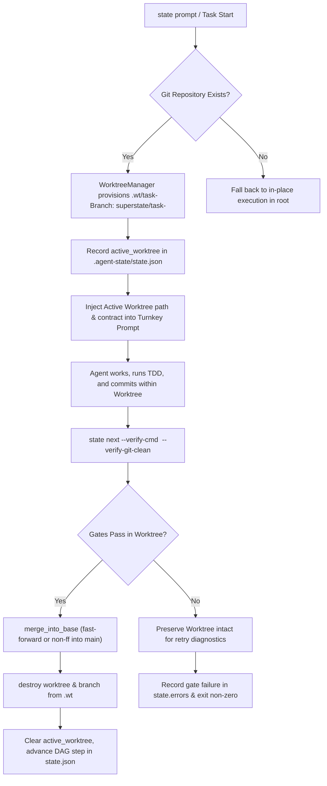

# Design Specification: State Engine Native Worktree Lifecycle

- **Author**: Superstate & Antigravity
- **Date**: 2026-09-10
- **Status**: Approved
- **Target Repository**: `superstate` and `superstate-eval`

---

## 1. Executive Summary

Superstate uses a deterministic state engine (`superstate state`) to guide autonomous agents through multi-step plans with strict verification gates and bounded context. While PR #10 integrated the `worktrunk` worktree manager (`superstate worktree` / `wt`), tasks are currently executed in-place within the repository's root working directory.

This design specification defines the architecture for making Git worktrees the native, default execution environment for all Superstate milestones. When an agent works on a milestone, Superstate automatically provisions an isolated worktree (`.wt/task-<id>`), directs execution and verification commands inside that worktree, atomically merges passing milestones back into the base branch (`main`), and cleans up worktrees upon completion.

---

## 2. Motivation & Problem Statement

1. **Working Tree Contamination**: Executing tasks in the primary working tree leaves untracked files, partial edits, and dirty states when tasks fail or require retries.
2. **Context Loss & Confusion**: Agents spend unnecessary reasoning turns inspecting outer git statuses, diagnosing whether uncommitted files are harness bookkeeping or task artifacts.
3. **Rollback Complexity**: Without worktree isolation, rolling back a failed milestone requires destructive git operations (`git reset --hard`, `git clean -fd`) that risk wiping out epistemic ledgers or harness metadata.
4. **Parallelism & Performance**: Worktree isolation enables concurrent execution across multiple subagents without branch collision or lock contention.

---

## 3. Architecture & Data Flow



---

## 4. Detailed Component Design

### 4.1 Schema Updates (`crates/superstate-core/src/models.rs`)

`ExecutionState` is updated to record the active worktree path and branch:

```rust
#[derive(Debug, Clone, PartialEq, Eq, Serialize, Deserialize)]
pub struct ExecutionState {
    pub status: ExecutionStatus,
    pub step: usize,
    #[serde(default)]
    pub active_task: Option<TaskSpec>,
    #[serde(default)]
    pub active_worktree: Option<PathBuf>,
    #[serde(default)]
    pub active_branch: Option<String>,
    #[serde(default)]
    pub pending_tasks: Vec<TaskSpec>,
    #[serde(default)]
    pub completed_tasks: Vec<TaskSpec>,
    #[serde(default)]
    pub modified_files: Vec<PathBuf>,
    #[serde(default)]
    pub errors: Vec<String>,
    #[serde(default)]
    pub plan_path: Option<PathBuf>,
    #[serde(default)]
    pub notes: Vec<LedgerEntry>,
}
```

### 4.2 Worktree Manager Lifecycle Extensions (`crates/superstate-worktree`)

`WorktreeManager` provides high-level helpers for milestone lifecycles:

* `ensure_task_worktree(repo_root: &Path, task_id: &str, base_branch: Option<&str>) -> Result<IsolatedWorktree, WorktreeError>`:
  Checks if `.wt/task-<slug>` already exists. If not, creates branch `superstate/task-<slug>` from the base branch, provisions `.wt/task-<slug>`, and reflinks common cache directories (`.venv`, `target`, `node_modules`).
* `merge_and_cleanup(wt: &IsolatedWorktree, commit_msg: &str) -> Result<(), WorktreeError>`:
  Merges changes from `wt.branch` into `wt.base_branch` in `repo_root`, and destroys the worktree checkout and removes the branch.
* `abort_task_worktree(wt: IsolatedWorktree) -> Result<(), WorktreeError>`:
  Forces removal of `.wt/task-<slug>` and deletes branch `superstate/task-<slug>`.

### 4.3 State Engine CLI Updates (`crates/superstate-cli/src/commands/state.rs`)

1. **`superstate state prompt`**:
   * If running inside a git repository, automatically provisions the worktree for the active milestone:
     ```rust
     let wt = worktree_mgr.ensure_task_worktree(&repo_root, &task.id, None)?;
     state.active_worktree = Some(wt.path.clone());
     state.active_branch = Some(wt.branch.clone());
     save_state_atomic(state_path, &state)?;
     ```
   * Appends the worktree working directory directive into the generated turnkey prompt:
     ```markdown
     ## 🌲 Active Isolated Worktree
     - Worktree Path: `.wt/task-1`
     - Branch: `superstate/task-1`
     - Working Directory: All modifications, tests, and git commits must take place inside this worktree!
     ```
   * Supports `--json` flag to return structured JSON containing `{ "task": ..., "worktree_path": "...", "prompt": "..." }`.

2. **`superstate state next`**:
   * Evaluates verification gates (`execute_all_gates`) **inside the active worktree** (`state.active_worktree`) if set.
   * If `--verify-git-clean` is passed, runs git clean checks inside the worktree checkout to ensure the agent committed all changes on the task branch.
   * If all gates pass:
     1. Executes `IsolatedWorktree::merge_into_base(&format!("feat({}): {}", task.id, task.title))`.
     2. Calls `IsolatedWorktree::destroy(false)`.
     3. Clears `state.active_worktree = None` and `state.active_branch = None`.
     4. Advances DAG step to next task and saves `state.json`.
   * If any gate fails:
     * Keeps worktree intact for subsequent retry turns.
     * Records failure output in `state.errors`.

3. **`superstate state rollback`**:
   * If `state.active_worktree` is populated, deletes the worktree and branches before restoring the git tag checkpoint.

### 4.4 Harness Integration (`superstate-eval`)

In `SuperstateAdapter` (`lab/engine/adapters/superstate.py`):
* Extracts the active worktree path from `superstate state prompt` / `state.json`.
* Directs `driver.run(workspace_path=active_worktree_path)`.
* In Docker sandbox execution, passes/binds the active worktree checkout to `/app` inside the container so all container commands execute cleanly in isolation.

---

## 5. Error Handling & Edge Cases

1. **Non-Git Projects**: If no git repository is present, Superstate logs an informative notice and executes in-place without erroring.
2. **Merge Conflicts**: If `merge_into_base` fails due to conflicts, `state next` records the conflict in `state.errors`, preserves the worktree, and halts with exit code 1.
3. **Dirty Primary Repo**: Worktrees are stored under `.wt/` which is added to `.git/info/exclude`, preventing worktree checkouts from dirtying the primary repository.
4. **Stale Worktrees**: Stale worktrees from previous runs are detected and cleaned up gracefully.

---

## 6. Verification & Test Plan

1. **Unit Tests**:
   * `crates/superstate-worktree`: Test `ensure_task_worktree`, `merge_and_cleanup`, and `abort_task_worktree`.
2. **Integration Tests**:
   * `crates/superstate-cli/tests/test_state_worktree_lifecycle.rs`: End-to-end integration test running `state init`, `state prompt`, making edits & commits in `.wt/task-1`, running `state next --verify-git-clean`, and verifying merge to `main` and worktree destruction.
3. **Eval Harness Suite**:
   * `pytest tests/test_pilot_runner.py` in `superstate-eval`.
   * Live evaluation run on `fastapi-deprecation-response-headers` under `superstate_rust`.
