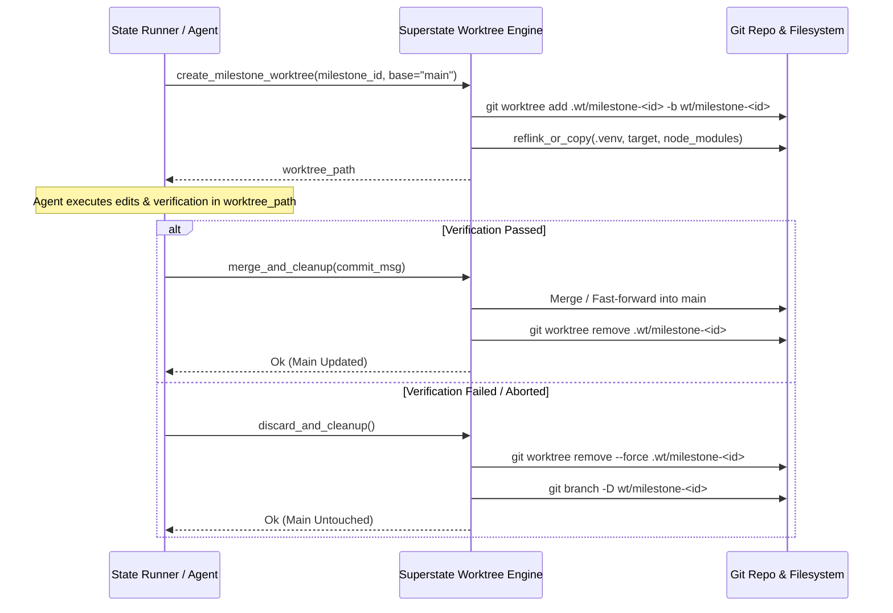

# Design Specification: Native Worktrunk Git Worktree Engine for Superstate

- **Author**: Antigravity & Climate X Engineering
- **Date**: 2026-09-10
- **Status**: Draft (Approved in Brainstorming)
- **Target Repository**: `superstate` (`crates/superstate-worktree`, `crates/superstate-cli`)

---

## 1. Problem Statement & Motivation

Superstate operates as a deterministic state machine for AI coding agents. Currently, milestone tasks execute directly in the primary workspace root (`cwd`). This introduces several risks and limitations:
1. **Working Tree Pollution**: Speculative agent edits, broken syntax, or partial code modifications modify the user's primary working tree directly.
2. **Brittle Rollback**: The current rollback mechanism relies on git checkpoint tags and `git reset --hard` + `git clean -fd`. If a process crashes or state desynchronizes, recovery can be destructive or complex.
3. **Serial Execution Bottlenecks**: Without isolated workspaces, concurrent execution of independent tasks (e.g., via `superstate state ready`) requires manual coordination or separate directory clones.
4. **Heavy Workspace Duplication Overhead**: Traditional git worktrees or clones do not share heavy directories (`.venv`, `node_modules`, `target`, `.cargo`), requiring slow, redundant dependency re-installation across worktrees.

---

## 2. Core Objectives

1. **Native Worktree Orchestration**: Embed `worktrunk` (`0.77.0`) in a dedicated workspace crate (`crates/superstate-worktree`) compiled without CLI/TUI features (`default-features = false`).
2. **COW Cache Sharing (Reflink)**: Utilize `worktrunk::copy::reflink_or_copy` to clone build and virtualenv caches (`.venv`, `node_modules`, `target`) in milliseconds via APFS (macOS) and btrfs/XFS (Linux) without extra disk consumption.
3. **Isolated Milestone Lifecycles**:
   - **Create**: Spawn an isolated worktree branch for a milestone (e.g., `wt/milestone-<id>`).
   - **Execute & Verify**: The agent performs edits and runs verification gates within the isolated worktree.
   - **Atomic Merge**: On verification gate pass, integrate the milestone worktree cleanly into the base branch.
   - **Zero Blast-Radius Teardown**: On verification failure or task cancellation, remove the worktree with `worktrunk::git::remove::remove_worktree_with_cleanup` without touching the base working tree.
4. **Native CLI Interface**: Expose `superstate worktree <create|merge|remove|list>` in `superstate-cli`.

---

## 3. Architecture & Crate Boundaries

```
                    +---------------------------------------+
                    |             superstate-cli            |
                    | (superstate worktree / state exec)    |
                    +---------------------------------------+
                                        |
                 +----------------------+----------------------+
                 |                                             |
                 v                                             v
    +--------------------------+                 +---------------------------+
    |     superstate-core      |                 |    superstate-worktree    |
    | (State machine, ledger,  |                 | (Worktree manager, COW    |
    |  milestones, schema)     |                 |  cache sharing, cleanup)  |
    +--------------------------+                 +---------------------------+
                                                               |
                                                               v
                                                 +---------------------------+
                                                 |   worktrunk (lib, no-cli) |
                                                 +---------------------------+
```

### 3.1. Crate `crates/superstate-worktree`
- **Dependencies**:
  - `worktrunk = { version = "0.77", default-features = false }`
  - `superstate-core = { path = "../superstate-core" }`
  - `serde = { workspace = true }`
  - `thiserror = { workspace = true }`
  - `tempfile = { workspace = true }`
  - `tracing` / `log`

### 3.2. Core Domain Types

```rust
/// Configuration for a milestone worktree.
#[derive(Debug, Clone)]
pub struct WorktreeConfig {
    pub base_path: PathBuf,
    pub branch_name: String,
    pub worktree_path: PathBuf,
    pub share_caches: Vec<String>, // e.g. [".venv", "node_modules", "target"]
}

/// Metadata and handle for an active isolated worktree.
#[derive(Debug)]
pub struct IsolatedWorktree {
    pub branch: String,
    pub path: PathBuf,
    pub base_branch: String,
    repo: worktrunk::git::Repository,
}

impl IsolatedWorktree {
    /// Create a new isolated worktree and reflink-copy specified caches.
    pub fn create(config: &WorktreeConfig) -> Result<Self, WorktreeError>;

    /// Reflink copy common project caches into this worktree.
    pub fn sync_caches(&self, cache_rel_paths: &[&str]) -> Result<u64, WorktreeError>;

    /// Integrate changes back into the base branch (squash or fast-forward).
    pub fn merge_into_base(&self, commit_message: &str) -> Result<(), WorktreeError>;

    /// Cleanly remove the worktree and prune worktree tracking metadata.
    pub fn destroy(self, force: bool) -> Result<(), WorktreeError>;
}
```

---

## 4. Worktree Lifecycle & Milestone Execution Flow



---

## 5. CLI Interface (`superstate worktree`)

The `superstate` binary will expose a `worktree` subcommand:
- `superstate worktree create <branch> [--base <branch>] [--path <path>] [--copy-caches]`
  Creates a new worktree and reflinks known project caches.
- `superstate worktree list`
  Lists all active worktrees and their integration status with the target branch.
- `superstate worktree merge <branch> [--target <branch>] [--message <msg>]`
  Merges the worktree branch into target and removes the worktree.
- `superstate worktree remove <branch> [--force]`
  Cleans up the worktree and its branch safely.

---

## 6. Testing Strategy

1. **Unit Tests (`crates/superstate-worktree/tests/test_worktree.rs`)**:
   - Create worktree from empty git repository.
   - Reflink-copy dummy virtualenv / directory tree into worktree.
   - Verify file modifications in worktree do not affect base repository.
   - Merge worktree commit into base repository and assert commit tree update.
   - Destroy worktree and assert working tree and git refs are clean.
2. **Integration Tests (`crates/superstate-cli/tests/test_worktree_cli.rs`)**:
   - CLI invocation of `superstate worktree create`, `list`, `merge`, and `remove`.
3. **Cross-Platform Reflink Verification**:
   - Verifies COW reflink on macOS (APFS `clonefile`) and fallback on non-reflink filesystems.
