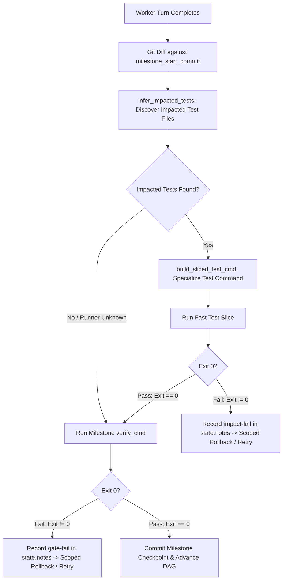

# Design Specification: Milestone-Scoped Test Impact Slicing in the Superstate Daemon

**Date:** 2026-09-19  
**Status:** Approved  
**Author:** Superstate Engineering Team  
**Initiative:** Initiative 2 from `docs/ROADMAP-DAEMON-CAPABILITIES.md`  

---

## 1. Executive Summary & Problem Statement

In enterprise codebases and complex multi-file tasks, executing a full test suite on every intermediate agent iteration introduces prohibitive latency. A single test run may require 2 to 15+ minutes. When an agent requires 3 to 5 iterative attempts to resolve a milestone, the majority of wall-clock time is spent re-executing un-impacted tests across the repository.

However, completely relying on an agent's self-selected test scoping frequently causes regression blind spots (the agent passes its newly written test while breaking existing shared modules).

### Core Objectives
1. **Fail-Fast Latency Elimination:** On each driver attempt within a milestone, run a fast, targeted test slice covering only the directly affected code. If the impacted tests fail, halt immediately (in seconds) and trigger the retry/rollback loop without waiting for the full suite.
2. **Zero Regression Leakage:** Before any milestone is marked completed and committed to the DAG, the full milestone `verify_cmd` must pass with exit code 0.
3. **Purely Mechanical Control Plane:** Zero prompt engineering. The state machine determines whether to run the fast slice or full suite based on git diffs, file heuristics, and Unix process exit codes.

---

## 2. Architecture & Staged Execution Lifecycle

When `--impact-slicing` is enabled on `superstate state daemon`, verification executes in a two-tier hierarchy:



### Invariants:
1. **Milestone-Scoped Diff Target:** The diff is computed against `milestone_start_commit` (recorded in `DaemonRunner` at the start of each milestone). Only files touched by the worker during the active milestone are considered.
2. **Deterministic Process Truth:** Process exit code `0` is required at both stages. No natural language or LLM evaluation is used.
3. **Graceful Fallback:** If zero impacted test files are identified, or if command specialization cannot recognize the test runner, the daemon falls back directly to `verify_cmd`.

---

## 3. Detailed Component Specifications

### 3.1 Command Specialization (`crates/superstate-core/src/impact.rs`)

We extend `crates/superstate-core/src/impact.rs` with `build_sliced_test_cmd`:

```rust
pub fn build_sliced_test_cmd(
    base_cmd: &str,
    impacted_files: &[PathBuf],
    repo_root: &Path,
) -> Option<String>
```

#### Runner Matching Logic:
1. **Pytest (Python):**
   - Matches: `pytest`, `python -m pytest`, `python3 -m pytest`, or prefixed commands like `./run-in-container pytest`.
   - Transformation: Replaces trailing generic test directories/arguments or appends the relative paths of `impacted_files`.
   - Example: `pytest tests/` $\rightarrow$ `pytest tests/unit/test_jwt.py`
2. **Cargo (Rust):**
   - Matches: `cargo test`
   - Transformation: For test files located in `tests/<stem>.rs`, maps to `cargo test --test <stem>`. For adjacent tests or subpackages, maps to `cargo test --package <pkg>`.
   - Example: `cargo test` with modified `crates/core/src/lib.rs` $\rightarrow$ `cargo test -p superstate-core`
3. **Go:**
   - Matches: `go test`
   - Transformation: Maps to the specific directory package containing the test file: `go test ./pkg/auth/...`
4. **Node / Vitest / Jest (TypeScript / JavaScript):**
   - Matches: `npm test --`, `yarn test`, `npx vitest run`, `npx jest`
   - Transformation: Appends relative paths: `npx vitest run tests/auth.test.ts`
5. **Fallback:**
   - If the runner cannot be safely identified or command syntax is arbitrary (e.g. `make test`, `sh verify.sh`), returns `None`.

### 3.2 Daemon State Machine (`crates/superstate-core/src/daemon.rs`)

In `DaemonRunner::step()`:
1. **Check Flag:** Check if `self.config.impact_slicing` is enabled.
2. **Discover Impacted Tests:**
   - Query `self.milestone_start_commits.get(&active_task.id)`.
   - Run `infer_impacted_tests(&working_dir, Some(&start_commit))`.
3. **Stage 1 (Impacted Slice Execution):**
   - If `impacted_files` is non-empty, call `build_sliced_test_cmd(verify_cmd, &impacted_files, &working_dir)`.
   - If specialized command is produced:
     - Run `run_verification_cmd(&sliced_cmd, &working_dir, self.config.timeout_secs)`.
     - If `!slice_res.passed`:
       - Record `[impact-fail] Task {}: Fast test slice failed: {}` to `state.notes`.
       - Trigger scoped rollback and return `DaemonStepOutcome::Failed` immediately.
     - If `slice_res.passed`:
       - Record `[impact-pass] Task {}: Fast test slice passed ({} files), executing full gate...` to `state.notes`.
4. **Stage 2 (Full Milestone Verification Gate):**
   - Run `run_verification_cmd(verify_cmd, &working_dir, self.config.timeout_secs)`.
   - If `!gate_res.passed`:
     - Record `[gate-fail]` and retry/rollback.
   - If `gate_res.passed`:
     - Commit milestone checkpoint and advance the task to completed.

### 3.3 Configuration & CLI (`crates/superstate-cli`)

1. **`DaemonConfig` in `superstate-core`:**
   ```rust
   pub impact_slicing: bool, // defaults to false
   ```
2. **CLI Args in `crates/superstate-cli/src/state_cli.rs` and `commands/daemon.rs`:**
   ```rust
   /// Enable milestone-scoped test impact slicing for fast progressive verification
   #[arg(long, help = "Enable milestone-scoped test impact slicing for fast progressive verification")]
   pub impact_slicing: bool,
   ```

---

## 4. Verification & Testing Plan

1. **Unit Tests (`crates/superstate-core/tests/test_impact_slicing.rs`):**
   - Test command specialization across Pytest, Cargo, Go, Jest/Vitest.
   - Test container wrapper prefixes (`./run-in-container pytest ...`).
   - Test fallback to `None` for custom scripts.
2. **Integration Tests (`crates/superstate-core/tests/test_daemon_impact_slicing.rs`):**
   - **Fast-fail scenario:** Sliced test fails $\rightarrow$ verify full `verify_cmd` is NOT executed, rollback occurs.
   - **Progressive pass scenario:** Sliced test passes $\rightarrow$ full `verify_cmd` executes and passes $\rightarrow$ milestone completed.
   - **Fallback scenario:** Zero impacted tests $\rightarrow$ directly executes `verify_cmd`.
3. **Workspace Verification:**
   - `cargo check --all`
   - `cargo test --all`
   - `cargo clippy --all-targets -- -D warnings`
